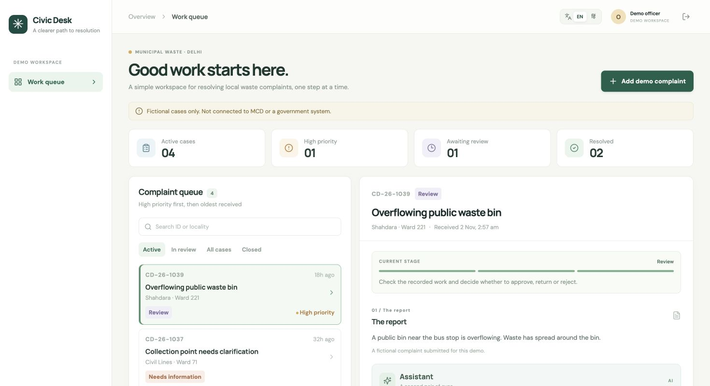

# Civic Desk / सिविक डेस्क

A bilingual, fictional officer workspace for uncollected-waste complaints. An officer can work from a prioritized queue, move a case through intake, field work and review, and approve, reject or return it with an audit note. An assistant offers context-specific suggestions; the officer makes every decision.

**This is a demo, not an MCD product or government service.** It uses invented reports, does not send messages to residents or field teams, and must not be used with real names, addresses, phone numbers or other personal data.

The draft was prepared with AI coding assistance. The candidate should review, test and understand it before any submission.



## The problem and the real-world basis

Field officers need a clear view of which waste reports are waiting, what has already been done, and what needs checking before closure. An MCD presentation describes citizen reports, officer assignment and resolution with comments and photos. A 2023 MCD circular called for resolution photographs and daily oversight; it is historical, not a claim about current deadlines. The demo borrows these concepts but **does not claim its exact states or buttons are official MCD procedures**. Sources and design boundaries are in [research/service.md](research/service.md).

## Run locally

Requires Node.js **22.13 or newer** and npm. Node's built-in SQLite module is experimental in Node 22.

```bash
npm ci
npm run dev
```

Open `http://localhost:5173`. The local-only demo login is `officer` / `local-demo-only`. It is deliberately for localhost; production refuses to start without configured credentials. The backend stores fictional data in `data/civic-desk.sqlite`, which is not committed. The UI supports English and Hindi; reports entered by a reviewer stay in their original language.

To enable a real model, copy `.env.example` to `.env` and set `OPENAI_API_KEY` on the server. `OPENAI_MODEL` is configurable and defaults to `gpt-6.1-sol`. Restart the server after changing `.env`. When no key is set, the assistant shows clearly labelled **rule-based example guidance**, not an AI result. When configured, it sends the case text and recent notes to the OpenAI Responses API only when the officer requests a suggestion. Never use real citizen data in this demonstration.

## Try the workflow

1. Sign in, switch between English and Hindi, and pick a fictional case in **Received**.
2. Request a suggestion, verify it, enter a note, and assign the case.
3. Record a fictional field update and send it for review.
4. Review the update, then approve, reject, or return it. Each human action is appended to the case history. Add a fictional complaint to start another run.

High-priority cases appear first, then older reports. Priority is a demo input, not an official formula or an AI decision. Returned cases can be reopened; returned reviews go back to field work. Every transition requires an officer's note. AI cannot change a case or create an event.

## Design and measurement

- React and TypeScript provide the bilingual responsive UI; Express serves a small same-origin JSON API. SQLite stores complaints and an append-only application event history.
- A finite transition table prevents illegal actions; version checks reject stale concurrent edits. The case update and event insertion share a transaction.
- The assistant receives only the selected fictional case and recent notes. Its instructions treat case text as untrusted, prohibit invented evidence and do not give it tools to alter data. The interface labels generated suggestions and warns that they require verification.
- The demo uses a single configured account, in-memory sessions, sign-in throttling and a 20-suggestion-per-hour IP limit. These limits are per process; it is a single-instance prototype, not production government authentication. Sessions do not survive a server restart. In production, use HTTPS and a strong unique demo password.
- To evaluate in a supervised pilot, establish a baseline and compare median time to assignment and verified closure, the proportion of incomplete cases returned, and the share of AI suggestions with unsupported statements. Define the period and sample size first. **No impact, adoption or time saving is claimed by this demo.**

## Checks

```bash
npm test
npm run build
```

The integration tests cover authentication, origin checking, no AI side effects, required notes, stale writes, allowed transitions, event history, creation and logout. They use an in-memory database and a stubbed model; the real model requires a configured key.

## Container and hosting

The Dockerfile builds the frontend and serves it with the API on port 3001. For a local container, set a strong `DEMO_PASSWORD` (at least 12 characters) and `DEMO_USERNAME` in a private, uncommitted `.env` file; optionally configure the OpenAI key there. Then:

```bash
docker build -t civic-desk .
docker run --rm -p 127.0.0.1:3001:3001 --env-file .env -v civic-desk-data:/data civic-desk
```

For a public reviewer demo, deploy the container behind HTTPS, set the credentials and API key as host-managed secrets, mount persistent storage at `/data`, and share a unique demo login privately. Do not commit secrets or use the local-only default password. A host's ephemeral filesystem will reset the SQLite data on restart unless persistent storage is configured. Hosted deployment and evaluator access have not been set up by this repository.
